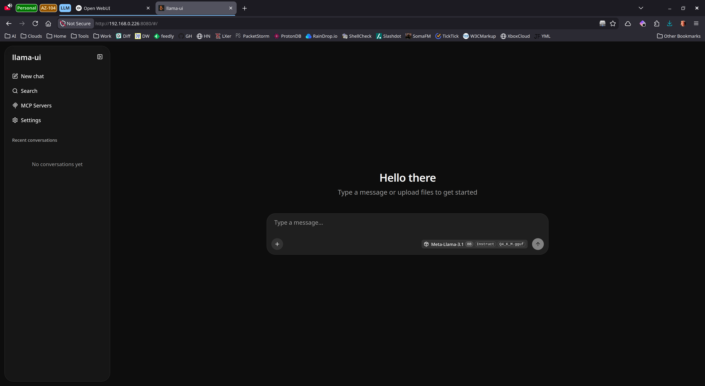
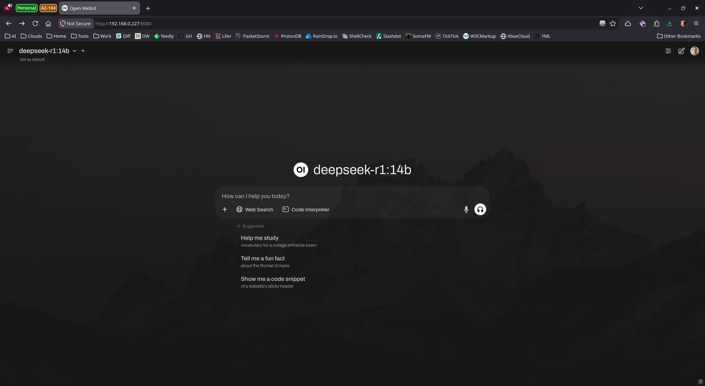

# scripts/llm

Shell installers for the local LLM stacks. Each targets one host. Three run as root on that host; `deploy-llama-ui-raw.sh` runs as your own user and uses sudo for its Docker commands. The same stacks also exist as
Ansible playbooks and as container stacks; the table at the end maps
the three forms so you can pick the right one.

## 📦 Contents

- [gpu-box-llm-setup-v1.9.sh](#gpu-box-llm-setup-v19sh)
- [optiplex-llm-setup-v2.1.sh](#optiplex-llm-setup-v21sh)
- [deploy-llama-ui-raw.sh](#deploy-llama-ui-rawsh)
- [setup_open_terminal-v1_2.sh](#setup_open_terminal-v1_2sh)
- [nanopi-llm-setup.sh](#nanopi-llm-setupsh)
- [See it running](#see-it-running)
- [Which form of each stack](#which-form-of-each-stack)

## gpu-box-llm-setup-v1.9.sh

Target: the GPU box (Nobara) with an AMD GPU. The script checks for
the ROCm compute device (`/dev/kfd`) and refuses to continue without
one; set `ALLOW_CPU_FALLBACK="yes"` at the top of the script to
override. Run as root.

What it deploys:

- Ollama, bare-metal via the official installer, as a systemd
  service. Configuration goes in a drop-in
  (`/etc/systemd/system/ollama.service.d/10-gpu-box.conf`) so it
  survives installer upgrades: `OLLAMA_HOST` bound to the detected
  LAN address on port 11434, `OLLAMA_KEEP_ALIVE=30m`. The invoking
  user's `.bashrc` gets the matching `OLLAMA_HOST` export.
- Five models, pulled through the API: qwen2.5-coder:14b,
  qwen2.5-coder:7b, deepseek-r1:14b, llava:13b, nomic-embed-text.
  The script warns that the first pull takes 30 to 60 minutes.
- SearXNG as a container on bridge networking, published on
  127.0.0.1:8888 by default. Its config is written on first run to
  `/etc/searxng/settings.yml` with a generated secret key. Set
  `SEARXNG_LISTEN_ADDR="0.0.0.0"` in the script to expose it on the
  LAN instead.
- Open WebUI as a container with host networking on port 8080, wired
  to Ollama and to SearXNG web search.
- firewalld rich rules opening 11434 and 8080 to the local network
  only, when firewalld is active (8888 as well if SearXNG is
  LAN-exposed).

Re-runs are idempotent: installed models are skipped, running
containers with matching configuration are left alone. An existing
Open WebUI container whose configuration no longer matches is
recreated; its old environment is first backed up to
`/var/log/open-webui-env-<timestamp>.txt`. Log file:
`/var/log/gpu-box-llm-setup.log`.

Knobs at the top of the script include `HSA_OVERRIDE_GFX_VERSION`
(11.0.0 for RDNA3, 10.3.0 for RDNA2, empty for autodetect) and
`OLLAMA_INSTALL_SHA256` (optional checksum pin for the Ollama
installer; without it the download runs unverified with a loud
warning). The Open WebUI and SearXNG images use floating `:latest`
tags, a recorded and accepted risk (TODO RISK-1 in the script); the
resolved image digests are written to the log on every run.

The full deployment guide for this script and the matching playbook
is `ansible/playbooks/llm/gpu-box-llm-setup-v2.3.md`.

## optiplex-llm-setup-v2.1.sh

Target: the OptiPlex (CPU-only, apt-based x86_64; written for the
i5-2400 under Linux Mint). Run as root.

What it deploys:

- llama.cpp built from source with `GGML_NATIVE=ON` and installed to
  `/opt/llama.cpp` (source checkout at `/usr/local/src/llama.cpp`).
  Re-runs rebuild only when the upstream commit changes.
- A `llm` system user that runs the service.
- One GGUF model in `/var/lib/llm/models`, selected by the
  `MODEL_PRESET` environment variable: `llama3.2-3b` (default,
  4096 context, weights page-locked) or `llama3.1-8b` (2048 context,
  not page-locked).
- A hardened `llama-server` systemd unit. The server binds
  127.0.0.1:8080 by default, and an API key is generated at
  `/etc/llm/api-key` (root:`llm`, mode 0640) and required either way.
  Setting `BIND_ADDR` to a LAN address adds a LAN-scoped UFW rule
  and restricts CORS to localhost origins.

`MODEL_SHA256` ships empty: the first run hashes the downloaded
model, caches the hash beside it, and warns. Paste the value into the
script to turn on real verification on later runs. Log file:
`/var/log/optiplex-llm-setup.log`. The full deployment and tuning
guide for this script and the matching playbook is
`ansible/playbooks/llm/optiplex-llm-v2.4.md`.

## deploy-llama-ui-raw.sh

A single raw `docker run` for the GPU box: starts a container named
`llama-ui` from the official llama.cpp server image
(`ghcr.io/ggml-org/llama.cpp:server`) with host networking, serving
the llama.cpp web UI on port 9999 and pointed at the bare-metal
Ollama from the GPU box setup above (`OLLAMA_BASE_URL` set to
`http://127.0.0.1:11434`). It then checks both front ends, Open WebUI
on 8080 and llama-ui on 9999, so it is a companion to the GPU box
stack, not a standalone deployment.

Docker is run through sudo. The script does not remove an existing
`llama-ui` container, so a re-run fails on the name until the old
container is removed. Manage it with the usual commands:
`sudo docker logs -f llama-ui`, `sudo docker restart llama-ui`,
`sudo docker rm -f llama-ui`.

## setup_open_terminal-v1_2.sh

Target: the GPU box (Nobara or another Fedora-based host with Docker).
Run as root. Deploys the Open Terminal container
(`ghcr.io/open-webui/open-terminal:slim`): a file I/O service that
Open WebUI models can call as a tool to create, read, modify, and
delete files. It offers no command execution and no shell access.

- HTTP API on 127.0.0.1:9000 only; nothing is exposed to the LAN.
- The file sandbox is the container's `/workspace`, backed by the
  host directory `/tmp/open-terminal-workspace` (mode 700).
- Hardening: read-only root filesystem, all capabilities dropped
  except SETUID, SETGID, and CHOWN, `no-new-privileges`, `--ipc=none`,
  tmpfs mounts for `/tmp`, `/run`, and `/home`, and limits of 1 CPU,
  256 MB RAM, and 50 PIDs.
- An API key is generated on first run at
  `/var/lib/open-terminal/api_key.txt` (mode 600) and must be sent as
  a Bearer token on every request.

After deploying, register the service in Open WebUI; the script
prints the steps and its header carries the full function schema.
Uninstall with `--uninstall`, which stops and removes the container
and deletes the workspace, the logs, and the API key. Note: the
script's header usage examples name the file
`setup_open_terminal-v1_2_hardened.sh`; the shipped filename is
`setup_open_terminal-v1_2.sh`.

## nanopi-llm-setup.sh

The bash form of the NanoPi inference pool — the same deployment as
`ansible/playbooks/llm/llm-server-setup.yml` and
`llm-lb-setup.yml`, derived from them step for step. One script, two
roles, run as root on the board itself:

```bash
# Inference node (pick the tier for the board's RAM):
./nanopi-llm-setup.sh --role server --tier 4gb
./nanopi-llm-setup.sh --role server --tier 2gb
# Load balancer board:
./nanopi-llm-setup.sh --role lb --nodes "192.168.1.101 192.168.1.102"
```

The Ansible inventory groups map onto flags: `llm_4gb` is
`--role server --tier 4gb` (Qwen2.5-Coder-7B-Instruct Q4_K_M),
`llm_2gb` is `--role server --tier 2gb` (the 1.5B model), and
`llm_lb` is `--role lb`, with the playbook's `llm_nodes` variable
becoming `--nodes` (the defaults are the playbook's: 192.168.1.101
labelled `4gb-heavy`, 192.168.1.102 labelled `2gb-light`, port
8080). The connection user (`ansible_user`) becomes `--user`, and
the inventory hostname becomes `--hostname`. A `--config` file can
carry the same settings for repeat runs.

What a server run does, in the playbook's order: sets the hostname
if asked, dist-upgrades, installs the build toolchain plus
`prometheus-node-exporter`, stops Bluetooth and Avahi where present,
clones llama.cpp into the user's home and builds it natively
(skipped while the binary exists), downloads the tier's GGUF model
into `~/models` (the URL is pinned to the model repo's commit and
the file is verified against Hugging Face's published SHA-256,
including when a copy is already present), renders the
`llama-server` systemd unit (port
8080, context 2048, n-predict 512, threads = CPU count) and enables
it, then configures UFW: OpenSSH allowed, the server port allowed
from the local /24 only, default deny.

A load balancer run installs nginx, removes the default site,
renders the same `llm-lb.conf` the Jinja template produces
(`least_conn` upstream, `/lb-health` answering `llm-lb ok`, 300s
proxy timeouts, buffering off), validates it with `nginx -t`,
enables nginx, and applies the same UFW shape for port 80.

Re-runs are idempotent: services restart or reload only when the
rendered unit or config actually changed. `--dry-run` prints every
changing command and changes nothing; `--print-config` prints the
rendered unit or nginx site and exits. The boards are ARM64; the
script warns on other architectures instead of refusing, because
the native build works the same way.

## See it running

The bare-metal deployments these installers produce, running at
home. Screenshots from my own systems, May 2026.



*The OptiPlex deployment from optiplex-llm-setup-v2.1.sh:
llama.cpp compiled natively and running under systemd, serving
Meta-Llama-3.1 8B Instruct (Q4_K_M) through llama-ui.*



*The GPU box deployment from gpu-box-llm-setup-v1.9.sh: Open
WebUI fronting the bare-metal Ollama install, deepseek-r1:14b
loaded.*

## Which form of each stack

| Stack | This folder (shell) | Ansible | Containers |
| --- | --- | --- | --- |
| GPU box (Ollama + Open WebUI + SearXNG) | `gpu-box-llm-setup-v1.9.sh` | `ansible/playbooks/llm/gpu-box-llm-setup-v1.9.yml` | `containers/gpu-llm` |
| OptiPlex (llama.cpp) | `optiplex-llm-setup-v2.1.sh` | `ansible/playbooks/llm/optiplex-llm-setup-v2.1.yml` | `containers/optiplex-llm` |
| NanoPi inference pool (llama.cpp servers + nginx LB) | `nanopi-llm-setup.sh` | `ansible/playbooks/llm/llm-server-setup.yml` + `llm-lb-setup.yml` | `containers/llm` |
| Open Terminal file service | `setup_open_terminal-v1_2.sh` | `ansible/playbooks/llm/open_terminal_setup.yml` | `containers/open-terminal` |

Differences that decide the choice:

- The GPU box shell script installs Ollama bare-metal and runs the
  two supporting services as containers. The container stack runs
  all three as containers, with every image pinned to a version tag
  and digest.
- The OptiPlex shell script compiles llama.cpp natively for the host
  CPU and runs it under systemd. The container stack uses the
  official image, verifies the model against a pinned SHA-256 on
  every start, and runs on any x86_64 Docker host.
- The NanoPi shell script and the playbooks are the same
  deployment in two runners: the script runs on the board itself,
  the playbooks drive the fleet from a control node. The container
  stack swaps the source build for the pinned llama.cpp image and
  moves the load balancer's published port to 8090.
- Pick the shell script for a single host set up by hand, the
  playbook for the same result managed through Ansible, and the
  container stack for a portable deployment with no source build and
  no systemd.
